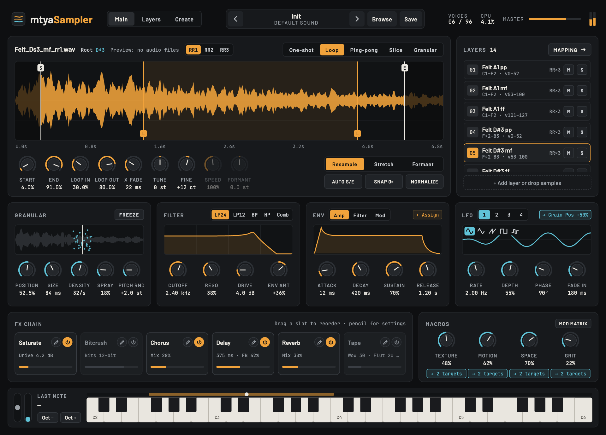
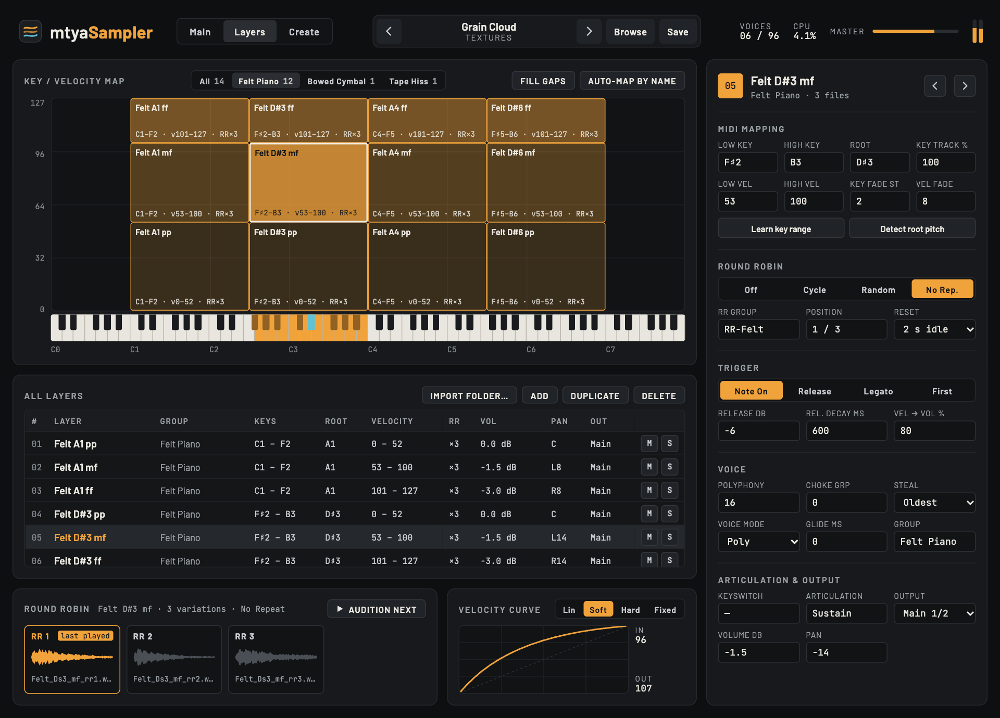

# mtyaSampler

A sampler instrument with sound-design tools (granular engine, filter, 3 envelopes, 4 LFOs, FX chain, macros) and a full multi-sample layer editor (key/velocity mapping, round robin, trigger modes, choke groups, keyswitches).

**Formats:** VST3 and CLAP instrument (plus a Standalone app for quick testing). Windows first; the code is cross-platform.

**Create your own samples:** the Create page is a recording assistant. You choose an instrument preset, note range, how often to sample (every note, every 3 notes…), round robins, velocity layers and the longest take. It then guides you note by note: it announces the note, plays a reference tone and counts you in, then records what you play into the plugin's input. Each take is trimmed, saved as a WAV and mapped straight into the Layers page.

**Status:** the UI is complete and wired to every parameter. The sampler engine plays the layers: key/velocity mapping with crossfades, round robin, trigger modes, voice modes, keyswitches all five playback modes (one-shot, loop, ping-pong, slice, granular), analogue-style filters that self-oscillate, three envelopes, four LFOs and macros with a modulation matrix, a reorderable FX chain, presets with a browser, multi-out (Bus 2–4), and sample tools (import, auto-map by name, detect root, snap to zero, normalize). Next: building and testing on Windows in a DAW; see [CLAUDE.md](CLAUDE.md), *Roadmap*.

**Where samples are found:** a layer's `samples` can be full paths or bare file names. Bare names are looked up in the instrument's `sampleFolder` (if set), then anywhere under `Documents\mtyaSampler\Recordings` and `Documents\mtyaSampler\Samples`, so takes from the Create page are found automatically. A file that can't be found plays a quiet sine at the layer's root, so you can still check the mapping; the header's `missing` count says how many.




## How it is built

| Part | Choice |
|---|---|
| Plugin framework | [JUCE 8](https://juce.com) with CMake, fetched automatically |
| CLAP | [clap-juce-extensions](https://github.com/free-audio/clap-juce-extensions), fetched automatically |
| UI | HTML/CSS/JS in `ui/`, shown with JUCE's `WebBrowserComponent` (WebView2 on Windows) |
| Parameters | One list, `ui/params.json`, read by both the C++ and the UI |

Why a web UI: the design was made as HTML, and it uses things that are slow to rebuild in JUCE's own components (live curves, a draggable zone map, tables and forms). The UI can also be developed in a normal browser without rebuilding the plugin.

## Build on Windows

You need:

- **Visual Studio 2022** with the *Desktop development with C++* workload
- **CMake 3.22+** and **Git** (both come with Visual Studio, or install separately)
- **The WebView2 SDK**, installed once from PowerShell:

  ```powershell
  Register-PackageSource -provider NuGet -name nugetRepository -location https://www.nuget.org/api/v2
  Install-Package Microsoft.Web.WebView2 -Scope CurrentUser -Source nugetRepository
  ```

Then, from this folder:

```powershell
cmake --preset vs2022
cmake --build --preset release
```

The first configure downloads JUCE and the CLAP extensions, which takes a few minutes. The results are in `build/mtyaSampler_artefacts/Release/`:

- `VST3/mtyaSampler.vst3` → copy to `C:\Program Files\Common Files\VST3\`
- `CLAP/mtyaSampler.clap` → copy to `C:\Program Files\Common Files\CLAP\`
- `Standalone/mtyaSampler.exe`, which runs without a DAW

## Recording your own samples (Create page)

1. **Get audio into the plugin.**
   - *Standalone app:* the easiest route. Pick your audio interface in its settings, and the input goes straight in.
   - *In a DAW:* send the track with your mic or instrument to the plugin's input. In Reaper, route the audio track to the instrument track's input pins; in Bitwig, use the device's sidechain/input selector. Use headphones, so the guide tone and count-in aren't recorded.
2. **Optional: spoken prompts through the DAW.** Run this once in PowerShell:
   ```powershell
   powershell -ExecutionPolicy Bypass -File tools\make-voice-pack.ps1
   ```
   It saves Windows' built-in voice saying each word to `Documents\mtyaSampler\VoicePack`. Without it, the plugin window speaks the prompts with the system voice instead.
3. On the **Create** page, choose your settings and press **Start session**. Space pauses and resumes. Click any cell in the take map to redo that take.

The samples are saved to `Documents\mtyaSampler\Recordings\<session name>` unless you choose another folder.

## Work on the UI without rebuilding

```powershell
cd ui
py -m http.server 8765
```

Open <http://localhost:8765>. Everything works in "preview mode": the parameters are kept in the page, and the layers come from `ui/demo-layers.json`.

To see UI changes inside the real plugin without rebuilding, build the `uidev` preset (`cmake --preset vs2022-uidev`, then `cmake --build --preset uidev`). It loads the UI from that local server instead of the copy built into the plugin.

## Engine tests

`tests/EngineTests.cpp` plays generated WAV files through the engine offline and checks pitch, round robin, velocity crossfades, trigger and voice modes, keyswitches, every playback mode, the filters (including self-oscillation), modulation, the FX and the sample tools. `tests/PluginTests.cpp` drives the real processor (buses, saved state). Build the `mtyaEngineTests` and `mtyaPluginTests` targets and run them; they print one line per check.

On a Mac (handy for engine work; the plugin also builds there as VST3/CLAP/Standalone):

```
cmake --preset mac
cmake --build --preset mac-release
build-mac/mtyaEngineTests_artefacts/Release/mtyaEngineTests
build-mac/mtyaPluginTests_artefacts/Release/mtyaPluginTests
```

**Presets** are saved to `Documents\mtyaSampler\Presets\<Category>\<Name>.mtyapreset` (every parameter plus the layers, modulation and FX order).

## Folder map

```
CMakeLists.txt         build (JUCE + CLAP + embedded UI)
Source/                C++: processor, editor (WebView host), parameter loader,
                       sampler engine (InstrumentMap, SamplerEngine, SampleLoader), recorder
tests/                 offline engine tests
ui/                    the interface: index.html, styles.css, js/, params.json, demo-layers.json
docs/ui-spec.md        pages, controls, bridge API, layer schema, parameter table
tools/                 make-voice-pack.ps1 (spoken prompts for the Create page)
docs/screenshots/      what the UI should look like
design/                the original design canvases (reference only)
CLAUDE.md              brief for Claude Code: decisions, rules, roadmap
```

## Licences

JUCE 8 is dual-licensed (AGPLv3, or a commercial licence that has a free tier for small developers). Check the JUCE licence before you distribute builds. clap-juce-extensions and the CLAP SDK are MIT.
