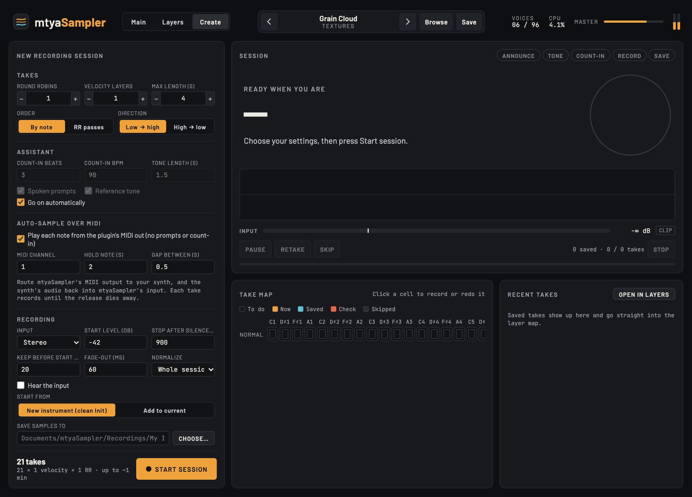
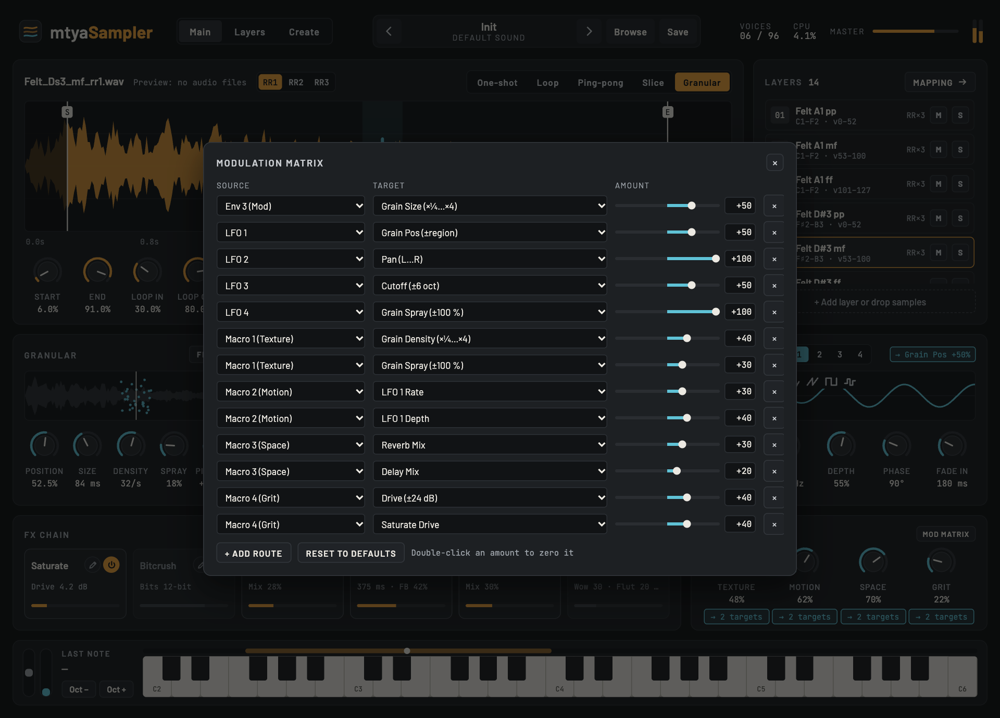

# mtyaSampler

A free, open-source sampler instrument (VST3, CLAP and Standalone) for sound designers and musicians: a granular engine, analogue-style filters that self-oscillate, a modulation matrix, a reorderable FX chain and a full multi-sample layer editor, plus a recording assistant that turns your own instrument (or a hardware synth, hands-free over MIDI) into a playable sampled instrument.


**[Read the manual](docs/MANUAL.md)** · [Website](https://mtyas.com) · [Support on Ko-fi](https://ko-fi.com/mtyas) · [GitHub](https://github.com/mtyas)

## Features

- **Five playback modes:** one-shot, loop (with crossfade), ping-pong, slice (16 slices across the keys) and granular (size, density, spray, pitch randomness, freeze).
- **Analogue-style filters:** a transistor-ladder LP24, LP12, BP, HP and a comb, all oversampled, all able to self-oscillate at full resonance.
- **Modulation:** three envelopes, four LFOs, four macros, mod wheel, aftertouch, velocity and key tracking, routed to any of 12 per-note targets or to any knob.
- **FX chain:** saturate, bitcrush, chorus, delay (tempo sync, ping-pong), reverb and tape (wow, flutter, drive). Drag them into any order, with full settings for each.
- **Multi-sample layers:** key and velocity zones with crossfades, round robin (cycle, random, no-repeat), release/legato/first-note triggers, choke groups, mono/legato with glide, keyswitches, and outputs to Bus 2–4.
- **Sample tools:** import a folder or drop files, auto-map by name (`Piano_C3_mf_rr2.wav`), fill gaps, detect root pitch, learn key range, snap to zero crossings, non-destructive normalize.
- **Create page:** a recording assistant that announces each note, plays a reference tone, counts you in, records, trims and maps every take. It can also play a MIDI instrument on its own and record it.
- **Presets** with categories, search and a browser.

| Layers | Create | Mod matrix |
|---|---|---|
|  |  |  |

## Install

There are no ready-made downloads yet: build it from source (below), then copy the plugin files:

| | Windows | macOS |
|---|---|---|
| VST3 | `C:\Program Files\Common Files\VST3\` | `~/Library/Audio/Plug-Ins/VST3/` |
| CLAP | `C:\Program Files\Common Files\CLAP\` | `~/Library/Audio/Plug-Ins/CLAP/` |

The Standalone app runs without a DAW. Your presets, recordings and samples live in `Documents/mtyaSampler/`.

## Build from source

The first configure downloads JUCE and the CLAP extensions automatically (a few minutes).

**Windows** (Visual Studio 2022 with *Desktop development with C++*, CMake 3.22+, Git). Install the WebView2 SDK once from PowerShell:

```powershell
Register-PackageSource -provider NuGet -name nugetRepository -location https://www.nuget.org/api/v2
Install-Package Microsoft.Web.WebView2 -Scope CurrentUser -Source nugetRepository
```

```powershell
cmake --preset vs2022
cmake --build --preset release
```

The plugins are in `build/mtyaSampler_artefacts/Release/` (`VST3/`, `CLAP/`, `Standalone/`).

**macOS** (Xcode command-line tools, CMake and Ninja; `pip3 install --user cmake ninja` works):

```bash
cmake --preset mac
cmake --build --preset mac-release
```

The plugins are in `build-mac/mtyaSampler_artefacts/Release/`.

**Tests:** `build-mac/mtyaEngineTests_artefacts/Release/mtyaEngineTests` (the sampler engine, offline) and `mtyaPluginTests` (the whole plugin: buses, saved state, MIDI auto-sampling). Each prints one line per check.

## Develop the UI in a browser

The interface is plain HTML/CSS/JS in `ui/`, shown inside the plugin with JUCE's `WebBrowserComponent` (WebView2 on Windows, WebKit on macOS). It also runs in a normal browser in "preview mode", with parameters and presets kept in the page:

```bash
cd ui
python3 -m http.server 8765
```

Then open <http://localhost:8765>. The `vs2022-uidev` preset builds a plugin that loads the UI from that server, so UI changes show up without rebuilding.

## Folder map

```
Source/            C++: processor, editor (WebView host), sampler engine, filters, FX, presets, recorder
ui/                the interface: index.html, styles.css, js/, params.json, fonts/
tests/             offline engine and plugin tests
docs/MANUAL.md     the user manual
docs/ui-spec.md    technical reference: bridge API, instrument JSON, modulation, parameters
docs/screenshots/  screenshots used by the docs
tools/             make-voice-pack.ps1 (spoken prompts for the Create page on Windows)
CLAUDE.md          notes for contributors (and Claude Code): decisions, rules, roadmap
```

## Support

mtyaSampler is free. If it's useful to you, you can support its development on **[Ko-fi](https://ko-fi.com/mtyas)**. Bug reports and ideas are welcome in the [issues](https://github.com/mtyas/mtyaSampler/issues).

## Licence

mtyaSampler is free software: you can use, study, change and share it under the **[GNU General Public License v3](LICENSE)** (or any later version).

It's built with [JUCE](https://juce.com), used under its free AGPLv3 licence, which also applies to builds you distribute. It also uses [clap-juce-extensions](https://github.com/free-audio/clap-juce-extensions) and the CLAP SDK (MIT). The bundled fonts, [Barlow](https://github.com/jpt/barlow) and [JetBrains Mono](https://github.com/JetBrains/JetBrainsMono), are under the SIL Open Font License (see `ui/fonts/`).
