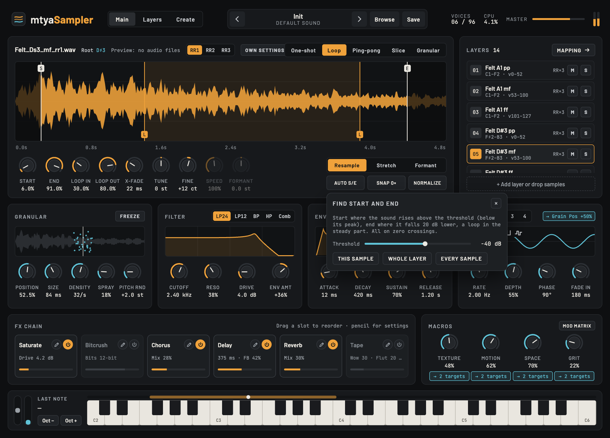
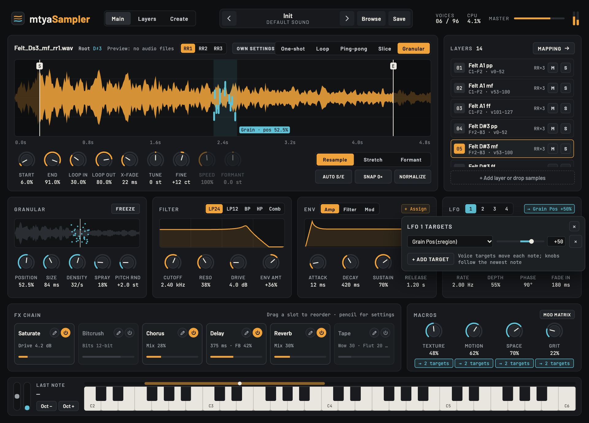
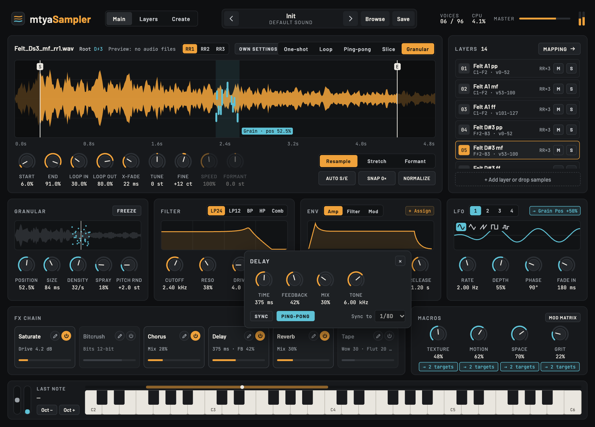
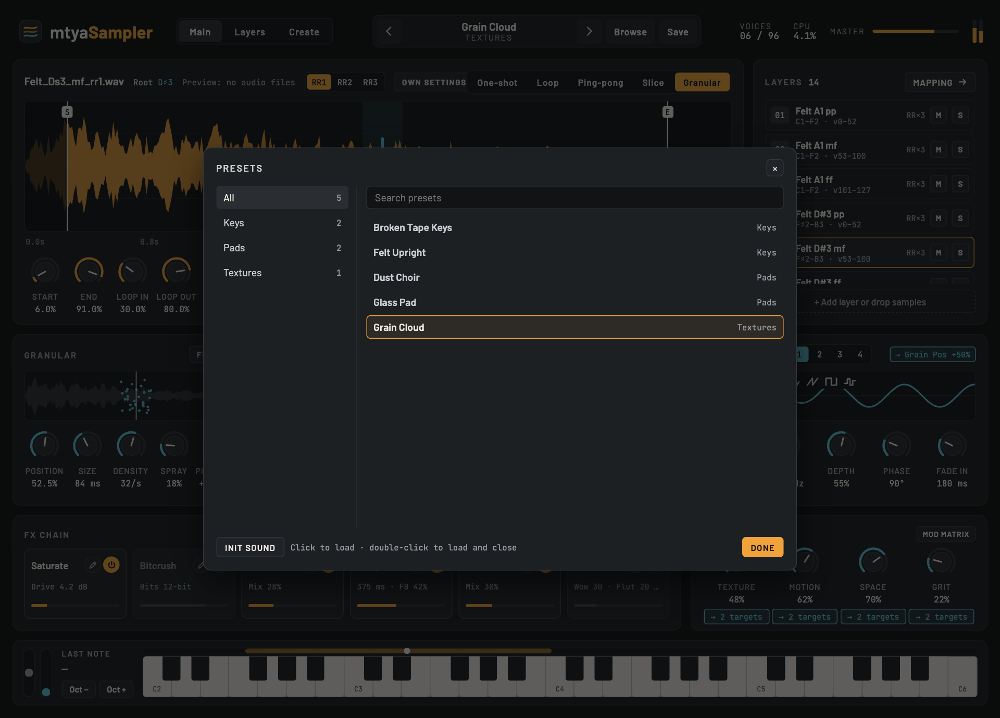
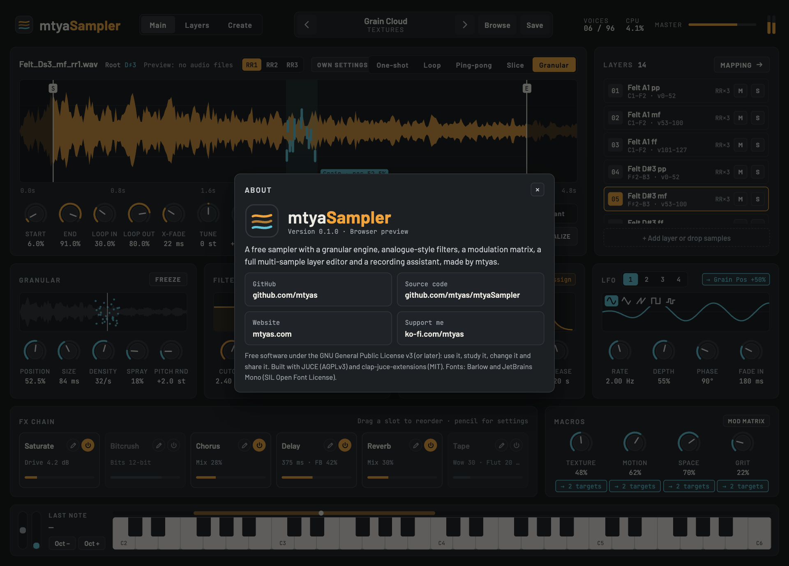

# mtyaSampler manual

mtyaSampler is a sampler with three pages: **Main** (play and shape the sound), **Layers** (map samples across keys and velocities) and **Create** (record your own samples). Switch pages with the buttons next to the logo. Click the logo for the **About** box (version, links, licence).

- [The basics](#the-basics)
- [Main page](#main-page)
  - [Sample editor and playback modes](#sample-editor-and-playback-modes)
  - [Granular](#granular)
  - [Filter](#filter)
  - [Envelopes and LFOs](#envelopes-and-lfos)
  - [Modulation: choosing what moves what](#modulation-choosing-what-moves-what)
  - [FX chain](#fx-chain)
  - [Macros](#macros)
  - [Keyboard](#keyboard)
- [Presets](#presets)
- [Layers page](#layers-page)
- [Bringing in samples](#bringing-in-samples)
- [Create page: recording your own samples](#create-page-recording-your-own-samples)
- [Sampling a synth automatically over MIDI](#sampling-a-synth-automatically-over-midi)
- [Outputs](#outputs)
- [Where files go](#where-files-go)
- [Tips and troubleshooting](#tips-and-troubleshooting)

## The basics

- **Knobs:** drag up or down. Hold **Shift** for fine moves, use the mouse wheel, or double-click to reset. With a knob selected, the arrow keys, Home and End also work.
- **Sliders and bars:** click or drag.
- **Every knob can be automated** from your DAW, and undo works through the host.
- The window can be resized from its corner and remembers its size. The whole UI scales with it.
- The header shows the preset, the voices playing (out of 96), CPU use, the **Master** volume and the output meter.

## Main page

### Sample editor and playback modes

The waveform shows the selected layer's sample, with these markers:

- A white **playhead** line for each note playing that sample, moving as it plays (in Granular mode it follows the grain position).
- **S** and **E**: where playback starts and ends.
- **L**: the loop points (shown in Loop and Ping-pong modes).
- Slice lines, or the grain window, depending on the mode.

**Every sample has its own points**, including each round-robin variation. When a layer has variations, **RR1, RR2…** next to the file name choose which one you're editing. You can also click a variation on the Layers page.

Edit the points by **dragging the S, E and L lines on the waveform**, or with the **Start**, **End**, **Loop In** and **Loop Out** knobs. The points stay in order: the loop always sits between start and end. **X-Fade** (the loop crossfade), **Tune** (semitones) and **Fine** (cents) apply to the whole instrument. The selected layer's **root** note is shown next to the file name.

**Own settings (per layer).** By default every layer follows the instrument's sample and granular knobs. Turn on **Own settings** (next to the file name) and the selected layer gets its own copy of them, starting from the current values: playback mode, pitch/time engine, Speed, Formant, Tune, Fine, X-Fade, and the Granular panel (Position, Size, Density, Spray, Pitch Rnd, Freeze). While that layer is selected, those controls edit just that layer, so you can have, say, a looping pad layer and a one-shot attack layer in the same instrument. Layers with their own settings show an **OWN** badge in the layer list. Turn it off to follow the instrument again (the layer's copy is kept, so turning it back on restores it).

A layer's own settings are saved with the instrument and presets but aren't automatable; the instrument's knobs are. Voice modulation (pitch, grain targets…) works on every layer, while a mod-matrix route to one of these knobs only moves the layers that follow the instrument.

**Pitch, time and formant.** The switch above the tool buttons chooses how samples are played back at other pitches:

| Engine | What happens |
|---|---|
| **Resample** | Like tape or a classic sampler: higher notes play faster and shorter, lower notes slower and longer. The most natural sound for most instruments. |
| **Stretch** | Pitch and time are independent. Notes keep the sample's length at any pitch, and the **Speed** knob (10–400 %) makes it longer or shorter without changing the pitch. Overlapping grains aligned to the waveform (WSOLA). Good for loops, textures and drums. |
| **Formant** | Like Stretch, but the sound's character (its formants) stays put when the pitch moves, so voices don't go "chipmunk" up high or boomy down low. The **Formant** knob shifts the character up or down on purpose (±12 semitones). Uses each sample's detected pitch (PSOLA), so it works best on pitched sounds (voice, strings, synths); use Stretch for noisy or unpitched ones. |

Speed and Formant are greyed out when they don't apply. Both can be automated and modulated. The engine works in One-shot, Loop, Ping-pong and Slice; Granular already keeps pitch and time separate.

**Auto S/E** finds the points from the sound level:

- **Start**: where the sound rises above the threshold, which is set relative to its peak (−40 dB by default), keeping 2 ms before it.
- **End**: where it last falls 20 dB below that threshold, plus 10 ms.
- **Loop**: placed in the steady part after the attack.

All of them land on zero crossings. Run it on **this sample**, the **whole layer** or **every sample**. Imported files get it automatically.

Choose how samples play with the switch at the top right:

| Mode | What it does |
|---|---|
| **One-shot** | Plays Start → End once. Releasing the key fades it out with the amp envelope. |
| **Loop** | Plays into the loop and repeats Loop In → Loop Out, crossfading at the seam (X-Fade) so it doesn't click. |
| **Ping-pong** | Bounces back and forth between the loop points. |
| **Slice** | Splits Start → End into 16 slices. The root key plays slice 1, the next key up slice 2, and so on, each at its original pitch. |
| **Granular** | Plays the sample as a cloud of short grains (see below). |

The buttons next to the knobs:

- **Snap 0×** moves the selected sample's start, end and loop points to the nearest zero crossings, so they don't click.
- **Normalize** turns the selected layer's level up until its loudest sample peaks at 0 dB. Your files aren't changed.

### Granular

| Control | What it does |
|---|---|
| **Size** | The length of each grain. |
| **Density** | How many grains start each second. |
| **Spray** | How far each grain's start point randomly moves from the position. |
| **Pitch Rnd** | Random detuning per grain, in semitones. |
| **Position** | Where in the sample (between Start and End) the grains come from. |
| **Freeze** | Holds the cloud at the position. When it's off, the position moves through the sample at normal speed. |

You can also set the position by dragging in the grain cloud display, or, in Granular mode, by dragging inside the waveform (away from the S and E lines). LFO 1 moves it by default.

### Filter

Pick a type with the switch: **LP24**, **LP12**, **BP**, **HP** or **Comb**. The curve shows the response.

| Control | What it does |
|---|---|
| **Cutoff** | The filter frequency. For Comb, it's the pitch of the comb. |
| **Reso** | Resonance. Above about 90 % the filter self-oscillates: it sings a sine at the cutoff even with no input, so you can play it like an oscillator. |
| **Drive** | How hard the signal hits the filter. Pushing it warms up and compresses the sound, like an analogue filter. |
| **Env Amt** | How far Env 2 opens (or, below 0, closes) the cutoff: up to ±6 octaves. |

The filters work like their analogue counterparts:

- **LP24** is modelled on a transistor ladder, with the classic thick sound and slight bass loss as the resonance goes up.
- **LP12, BP and HP** compress gently on loud resonant peaks.
- **Comb** rings like a plucked string as the resonance goes up.

All of them run at double the sample rate, and fast cutoff moves glide instead of clicking.

### Envelopes and LFOs

**Env** has three tabs, each with Attack, Decay, Sustain and Release:

- **Amp (Env 1)** shapes the volume of every note, and can also modulate anything else.
- **Filter (Env 2)** drives the cutoff through Env Amt, and can modulate anything else too.
- **Mod (Env 3)** is free to modulate anything. By default it lengthens the grains.

**LFO** has four tabs, each with:

- a shape: sine, triangle, saw, square or sample & hold
- **Rate**
- **Depth**
- **Phase**: where it starts on each note
- **Fade In**: how long it takes to reach full depth

Each note gets its own LFOs, starting when the note does.

### Modulation: choosing what moves what

The tag at the right of the Env and LFO panels shows where that envelope or LFO goes, for example **→ Grain Pos +50%**. Click it to change it:

- Choose a **target**, and set the **amount** from −100 % to +100 %. Negative amounts move the other way. Double-click the amount slider to zero it.
- **+ Add target** sends the same source to several places. **×** removes a target.

There are two kinds of target:

- **Voice targets** (the first group in the list) move each note on its own: an LFO on Cutoff wobbles every note separately.
- **Knobs:** any knob in the plugin, from an effect's mix to an LFO's rate. A knob is shared by all notes, so an envelope or LFO moving it follows the most recently played note. Macros, the mod wheel and aftertouch are the same for every note anyway.

What 100 % means for each voice target:

| Target | 100 % means |
|---|---|
| Pitch | ±24 semitones |
| Volume | from silent to double |
| Pan | hard left to hard right |
| Cutoff | ±6 octaves |
| Resonance | the whole resonance range |
| Drive | ±24 dB |
| Grain Pos | across the whole sample |
| Grain Size / Density | ×¼ to ×4 |
| Grain Spray | the whole spray range |
| Grain Pitch Rnd | ±12 semitones |
| Sample Start | moves the start up to the end (read when the note starts) |

**Mod matrix** (in the Macros panel) shows every connection in one list:

The matrix also has sources without a panel of their own:

- **Mod wheel** and **Aftertouch** from your keyboard.
- **Velocity**: how hard you play.
- **Key track (pitch)**: how far the note is above or below C3, for things like brighter high notes or shorter grains up the keyboard.

For a knob, 100 % sweeps its whole range. **Reset to defaults** brings back the starting routing.

### FX chain

The six effects run in a row, left to right:

- **Drag a slot** by its name or dots to change the order. With one of a slot's buttons focused, **Alt + ←/→** also moves it.
- The **power button** turns an effect on or off, with a short fade so it doesn't click.
- The **bar** sets the effect's main amount.
- The **pencil** opens all its settings:

| Effect | Settings |
|---|---|
| **Saturate** | Drive, Type (Soft, Hard, Tube, Fold), Tone, Mix |
| **Bitcrush** | Bits, Rate (lower = grittier, aliased), Mix |
| **Chorus** | Mix, Rate, Depth, Feedback |
| **Delay** | Time, or **Sync** to the host tempo with a division (1/32 to 1/1, dotted and triplet); Feedback, Mix, **Ping-pong**, Tone (repeats get darker) |
| **Reverb** | Mix, Size, Damping, Width, Pre-delay |
| **Tape** | Wow (slow pitch drift), Flutter (fast wobble), Drive (tape saturation), Tone (high-frequency loss), Mix. Off by default. |

The order is saved with the preset.

### Macros

Four performance knobs: **Texture**, **Motion**, **Space** and **Grit**. Each controls several things at once. The button under each macro shows its targets; click it to change them, exactly like an LFO.

Here's what each one controls at first:

| Macro | Controls at first |
|---|---|
| Texture | grain density and spray |
| Motion | LFO 1's rate and depth |
| Space | reverb and delay mix |
| Grit | filter drive and saturation |

### Keyboard

- Click the keys, or use your computer keyboard: **A W S E D F T G Y H U J K** play one octave.
- Playing a key selects the layer it plays (at velocity 100), so the sample editor shows that sample. If the selected layer already covers the key, it stays selected.
- **Oct − / Oct +** shift the range.
- On the left are the pitch wheel (±2 semitones) and the mod wheel.
- The bar above the keys shows the selected layer's key range (amber) and root key (cyan).
- A sustain pedal (CC 64) on your MIDI keyboard holds notes.

## Presets

The preset name is in the middle of the header:

- **< / >** step through your presets.
- **Save** stores the current sound with a name and category. Saving with the same name replaces it.
- **Browse** lists your presets by category, with a search box. Click a preset to load it; double-click to load it and close the browser.
- **Init sound** gives a clean, empty starting point: no effects, filter open, nothing modulated, a simple envelope, One-shot playback and no layers. New instruments from the Create page start from the same Init.

A preset contains every knob, every layer, the modulation routing and the FX order. Presets are files in `Documents/mtyaSampler/Presets/<Category>/`, so you can back them up or share them.

## Layers page

An instrument is made of **layers**. Each layer is one or more samples that play over a range of keys and velocities.

- **Key / Velocity Map:** each box is a layer, with keys across and velocity up. Click a box to select it, drag it to move it, drag its edges to resize it, or nudge it with the arrow keys. **Double-click** a box to open its sample in the editor on the Main page (this works on table rows and round-robin slots too). The group buttons above show one group at a time.
  - **Fill gaps** stretches neighbouring zones so no keys are left silent.
  - **Auto-map by name** reads the note and dynamic from the sample names and lays the zones out for you.
- **All Layers:** a table of every layer, with mute and solo. **Import folder…**, **Add**, **Duplicate** and **Delete** are above it.
- **Round Robin:** the selected layer's variations. **Audition next** plays the next one.
- **Velocity Curve:** Lin, Soft, Hard or Fixed, for the whole instrument.

The **inspector** on the right edits the selected layer:

| Section | Settings |
|---|---|
| **MIDI Mapping** | Low/High key, Root, Key Track (0 % = same pitch on every key), Low/High velocity, and Key/Vel Fade, which crossfades with the neighbouring zone. **Learn key range** asks you to play the lowest and highest key. **Detect root pitch** listens to the sample and sets the root. |
| **Round Robin** | Off, Cycle, Random or No Repeat. Layers that share an **RR Group** stay in step, so all velocity layers play the same variation. **Reset**: never, after 2 s idle, or when the transport starts. **Position** shows which variation plays next. |
| **Trigger** | **Note On** (normal), **Release** (plays when you let go, e.g. piano key noise, quieter the longer the key was held, set by Release dB and Rel. Decay), **Legato** (only while another key is held), **First** (only when no other key is held). **Vel → Vol** sets how much velocity changes the level. |
| **Voice** | **Polyphony**, **Steal** (which note to drop when you run out), **Voice Mode** (Poly; Mono, which retriggers; Legato, which glides without retriggering), **Glide** time, **Choke Grp** (layers in the same group cut each other, like open and closed hi-hats). |
| **Articulation & Output** | **Keyswitch**: the layer only plays after you press that key. Key notes make no sound, and the lowest keyswitch is active at first. **Articulation** name, **Output** (Main or Bus 2–4), **Volume**, **Pan**. |

## Bringing in samples

- **Import folder…** (Layers page): pick a folder, and every audio file in it (WAV, AIFF, FLAC, OGG or MP3) becomes layers, mapped by name, with start and end points found automatically (for folders of up to 300 files; use **Auto S/E → Every sample** for bigger ones).
- **Drag and drop:** drop audio files anywhere on the window. They're copied to `Documents/mtyaSampler/Samples/Dropped` and mapped the same way.
- **Naming:** the mapper understands names such as:
  - `Piano_C3_mf_rr2.wav`
  - `Bass-F#1-ff.wav`
  - `Pad_Db4_v100.wav`
  - `MySynth_Ds2_p_rr1.wav` (the Create page's style, where `s` means sharp)

  It reads the note, the dynamic (`ppp` to `fff`, or `v` plus a number) and the round-robin number. Files with the same note and dynamic become one layer, with each file as a round-robin variation. Dynamics become velocity layers, and the key ranges are split between neighbouring notes. Files with no note in the name (drums, one-shots) go on consecutive keys from C1.
- C3 is MIDI note 60 everywhere in mtyaSampler.

If a layer's file can't be found, it plays a quiet sine at its root note instead, so you can still check the mapping. Bare file names are looked for in `Documents/mtyaSampler/Recordings` and `Documents/mtyaSampler/Samples`.

## Create page: recording your own samples

The Create page records a whole instrument with you, note by note.

1. **Get audio into the plugin.**
   - *Standalone app:* choose your audio interface in its settings; the input goes straight in.
   - *In a DAW:* send the track with your mic or instrument to mtyaSampler's input ("Record In"). In Reaper, route it to the instrument track's input pins; in Bitwig, use the device's sidechain/input selector.
   - Use headphones, so the guide tone and count-in aren't recorded.
2. **Choose a preset:** Voice, Guitar, Keys/Piano, Bass, Strings & Winds, Hardware Synth, Drums & One-shots or Custom.
3. **Notes:** the lowest and highest note, and **Sample every…** note, 2–6 semitones or octave. The keyboard preview shows which notes get recorded.
4. **Takes:**
   - **Round robins** (1–8) and **velocity layers** (1–4).
   - **Max length** per take.
   - The **order**: by note, or one pass per round robin.
   - The **direction**: low to high, or high to low.
5. **Assistant:** count-in beats and tempo, tone length, spoken prompts, reference tone, and whether to **go on automatically** after each take.
6. **Recording:**
   - **Input:** stereo, left or right.
   - **Start level:** what counts as sound.
   - **Stop after silence:** how long a quiet tail lasts before the take ends.
   - **Keep before start**, the **fade-out**, and **normalize** (each take, the whole session, or off).
   - **Hear the input**.
   - **Start from**: **New instrument** (the default) begins from the clean Init (below), named after the session. **Add to current** adds the session's layers to the instrument you have open.
   - The save folder.
7. Press **Start session**.

During a session:

- The step strip shows **Announce → Tone → Count-in → Record → Save**. Each take is trimmed, saved as a WAV and dropped into its layer straight away.
- **Space** pauses and resumes. **Retake** redoes the last take, **Skip** moves on, and **Stop** ends the session.
- Click any cell in the **Take Map** to record or redo that take.
- **Recent Takes** lists the last takes with warnings (clipped, nothing heard). **Play** listens back, and **Redo** records it again.

**Spoken prompts on Windows:** run `tools\make-voice-pack.ps1` once, and the plugin speaks through your DAW. Otherwise the window speaks with the system voice.

## Sampling a synth automatically over MIDI

The Create page can play a MIDI instrument by itself and record it, with no one at the keys. It works for a hardware synth, a drum machine or another plugin.

1. Pick the **Hardware Synth** preset, or tick **Play each note from the plugin's MIDI out** under *Auto-sample over MIDI*.
2. Set the **MIDI channel**, **Hold note** (how long each note is held) and **Gap between** notes.
3. Connect the synth both ways:
   - *Standalone app:* in its settings, choose the **MIDI output** device (your synth's MIDI port) and the **audio input** (the synth's audio).
   - *Reaper:* send the mtyaSampler track's MIDI to the synth's track or hardware MIDI output. Route the synth's audio into mtyaSampler's input pins.
   - *Bitwig:* use a Note Receiver or HW Instrument for MIDI, and the sidechain input for audio.
4. Press **Start session**.

For each take, mtyaSampler waits the gap and sends the note as recording starts. It holds the note for the hold time, then releases it and keeps recording until the release dies away.

- Velocity layers are played at the top of their range, or at 100 when there's only one.
- The prompts, tone and count-in are skipped.
- Notes are always released when you pause, skip or stop, so nothing hangs.

## Outputs

mtyaSampler has a stereo main output plus **Bus 2, Bus 3 and Bus 4**.

- Switch the extra buses on in your DAW's routing for the plugin, then set a layer's **Output** in the inspector. That lets you mix or process layers separately, for example drums.
- Layers on Bus 2–4 skip the FX chain and Master volume.
- If a bus is switched off, its layers play on Main.

## Where files go

Everything lives in your **Documents/mtyaSampler** folder:

| Folder | Contents |
|---|---|
| `Presets/<Category>/` | your presets (`.mtyapreset`) |
| `Recordings/<Session>/` | takes from the Create page |
| `Samples/` | samples you keep for mtyaSampler; `Samples/Dropped/` holds dropped files |
| `VoicePack/` | spoken prompts (Windows, optional) |

## Tips and troubleshooting

- **Silence, or a plain sine tone:** the layer's sample file wasn't found. Re-import it, or keep your samples under `Documents/mtyaSampler/Samples`.
- **Clicks at the loop point:** raise **X-Fade**, or press **Snap 0×**.
- **Silence or a late attack at the start of a note:** that sample's Start is too late, or the file has a silent lead-in. Drag **S**, or use **Auto S/E**.
- **Squealing filter:** the resonance is in the self-oscillation zone (above about 90 %). Turn it down, or play with it.
- **Computer keys don't play in a DAW:** some hosts take keystrokes first. Click the keyboard or use MIDI.
- **The Create page hears nothing:** check the input routing and the **Start level**. The input meter on the Session panel should move when you play.
- **Hanging notes on a hardware synth:** shouldn't happen. mtyaSampler always sends note-off when a take stops. If one does hang, send "all notes off" from your DAW, and please report it.

---

mtyaSampler is free software under the GNU GPL v3. Made by [mtyas](https://mtyas.com) · [GitHub](https://github.com/mtyas) · [Support on Ko-fi](https://ko-fi.com/mtyas)

